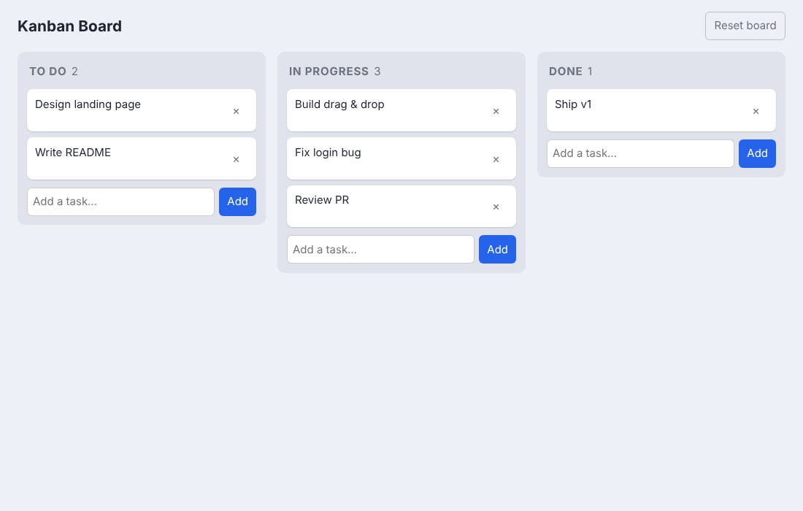

# Kanban Board

 

**[▶ Live demo](https://showa21.github.io/kanban-board/)**

A drag-and-drop task board in **vanilla JavaScript** — no frameworks, no build step.

- Three columns (To do / In progress / Done) with live counts
- Drag cards between columns using the HTML Drag and Drop API
- Add and delete tasks; state persists in `localStorage`
- Safe rendering (text set via `textContent`), responsive grid, automatic dark mode

## Run
Open `index.html` in a browser.
